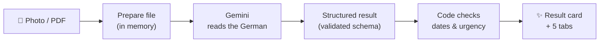

# 📬 Briefklar

**Understand any German official letter in seconds.**
Upload a photo or PDF of a letter from a Behörde, insurer or landlord, and Briefklar tells you, in plain language, what it says, what you need to do and by when, **in English, Spanish, Turkish, Arabic, Ukrainian or any other language you choose.**

*Built with Python, Streamlit and Google Gemini (vision).*

---

## The problem

Anyone who moves to Germany soon learns that important things that arrive **by post**, in formal German, full of legal terms:

> *„Gegen diesen Bescheid kann innerhalb eines Monats nach Bekanntgabe Widerspruch erhoben werden.“*

These letters come from the Ausländerbehörde, Finanzamt, Krankenkasse, landlords and debt collectors. They often contain a **deadline**, and missing it can mean late fees, legal enforcement or a delayed residence permit.

Translation apps help with the words, but not with the questions that matter:

- *Is this serious, or just information?*
- *What exactly do I have to do?*
- *By when?*
- *What happens if I ignore it?*

**Briefklar answers those four questions.**

---

## What you get

Upload a letter and Briefklar shows one clear result card plus five tabs:

| | What you see |
|---|---|
| **Result card** | Who sent it, what it's about, an **urgency level** (low / medium / high) with the reason, and a **countdown ring** showing the days left |
| ✨ **Summary** | A short plain-language explanation, plus what happens if you ignore it |
| ✅ **To-do** | Each step as a card you can tick off, with amounts, IBANs and addresses taken from the letter |
| 📅 **Dates** | A timeline of every date in the letter, marking which are past and which are coming up |
| 📖 **Glossary** | The German terms used in *this* letter, explained (*Frist*, *Widerspruch*, *Bescheid* …) |
| 🔖 **Details** | Reference numbers to quote when you reply (*Aktenzeichen*, *Kassenzeichen*), and a summary download |

It also warns you when:
- a deadline is **estimated** (*"within two weeks of receipt"*) rather than an exact date,
- the letter is **old** and its deadlines have already passed.

### 🌐 Your language

Pick a language at the top right and **the whole app switches**: buttons, tabs, labels and the explanation itself.

- **16 built-in languages:** English, Español, Türkçe, العربية, Українська, Русский, Polski, Français, Português, Italiano, Română, हिन्दी, فارسی, Tiếng Việt, 中文 and *Deutsch (einfach)*, simple German for learners.
- **Any other language:** choose **🌍 Other…** and type it (e.g. *Swahili*, *Tamil*, *Kurdish*). The interface is translated on the fly the first time and then cached.
- **Switch at any time,** even after a letter is decoded. The result is translated without uploading the letter again, and switching back is instant.
- **Facts never change between languages.** Dates, amounts, reference numbers and urgency are copied from the original result in code, so a translation can't alter them.
- **The German stays German** where it matters: glossary terms, the deadline's original wording and form names, so you can match them to the letter.
- Arabic, Persian, Urdu and Hebrew get a **right-to-left** layout.

---

## How it works



1. **Prepare the file.** Phone photos are rotated upright (using the photo's EXIF data), shrunk to at most 2000 px and re-saved as JPEG. PDFs are sent as they are. iPhone HEIC photos are supported, and so are letters split across several photos.
2. **Read and explain.** The file goes to Gemini, which reads the image directly. A vision model works better than classic OCR here: it understands the page layout, so it can tell the *Aktenzeichen* from the IBAN, and it copes with stamps, angles and bad lighting.
3. **Structured output.** Gemini must answer in a fixed format (a Pydantic schema in `letter_analyzer.py`), so every result has the same fields. For example, `urgency` can only be `low`, `medium` or `high`.
4. **Check the dates in code.** Language models are unreliable with date arithmetic, so the date rules live in code:
   - a deadline within **14 days** is always marked **high** urgency,
   - action dates that have already passed trigger a warning,
   - dates from before the letter was written count as background, not missed deadlines.
5. **Show it.** Streamlit draws the result card and tabs. All model text is HTML-escaped first, so nothing in a letter can inject code into the page.
6. **Change language.** Interface texts come from `i18n.py` (English) and `locales/<code>.json` (pre-translated). When you switch language after decoding, only the *result text* goes back to Gemini for translation, never the letter, and the facts are copied back from the original.

### Handling problems

| Situation | What the app does |
|---|---|
| Google's free model is overloaded (503) | Switches automatically to a backup model |
| A model is retired (404) | Moves on to the next model in the list |
| Free-tier rate limit (429) | Asks you to wait a minute and try again |
| Invalid key, or a project with billing problems | Shows a clear message with the fix |
| A photo that isn't a letter | Warns that the results may not be meaningful |

---

## Privacy

- **Briefklar stores nothing.** Files are processed in memory and never written to disk or a database. Results disappear when you close or reload the tab.
- Streamlit's usage tracking is turned off, and the app runs only on your own computer (`localhost`).
- **Be aware:** the letter is sent to Google's Gemini API to be analysed. On Gemini's **free tier**, Google may use what you send to improve its products, and human reviewers may read it. **Black out your name, address and ID numbers before uploading**, or use the built-in sample letter. A production version should use a paid tier, where your data isn't used this way.

---

## Getting started

### 1. Get a free API key
Create one at **<https://aistudio.google.com/apikey>** (no credit card needed).
Create it in a project **without billing**, otherwise Google won't apply the free tier.

### 2. Install

```bash
git clone <your-repo-url> german-letter-explainer
cd german-letter-explainer
python -m venv .venv
.venv\Scripts\activate            # macOS / Linux: source .venv/bin/activate
pip install -r requirements.txt
```

### 3. Add your key
Copy `.env.example` to `.env` and paste in your key:

```
GEMINI_API_KEY=your-key-here
```

### 4. Run

```bash
streamlit run app.py
```

Your browser opens at **http://localhost:8501**. Click **🎲 Try a sample letter** to test it without uploading anything personal. Press `Ctrl + C` in the terminal to stop the app.

### Optional settings (`.env`)

| Variable | Default | Purpose |
|---|---|---|
| `GEMINI_API_KEY` | *(required)* | Your Gemini API key |
| `GEMINI_MODEL` | *(not set)* | A model to try first, e.g. `gemini-flash-latest` for more thorough but much slower answers |

Without `GEMINI_MODEL`, the app uses `gemini-3.1-flash-lite` (a few seconds per letter) and falls back to `gemini-flash-lite-latest`.

---

## Project structure

```
german-letter-explainer/
├── app.py                  # Page flow: upload, progress steps, result tabs, to-do list
├── letter_analyzer.py      # File preparation, prompt, Gemini call, schema, date rules
├── ui.py                   # HTML building blocks: hero, result card, timeline, glossary
├── i18n.py                 # Language list, English interface texts, live translation, RTL
├── locales/                # Pre-translated interface texts, one JSON file per language
├── tools/
│   └── build_locales.py    # Regenerates locales/ with Gemini
├── assets/style.css        # Theme: animated background, glass cards, coloured tabs
├── samples/
│   └── sample_letter.txt   # A made-up fee notice for demos
├── .streamlit/config.toml  # Dark theme, 20 MB upload limit, telemetry off
├── requirements.txt
└── .env.example            # Template for your API key
```

**Tech stack:** Python 3.10+ · Streamlit · Google Gen AI SDK (`google-genai`) · Pydantic · Pillow (+ `pillow-heif`)

### Adding a language

1. Add a line to `LANGUAGES` in `i18n.py`, e.g. `Language("Shqip", "Albanian", "sq")`.
2. Run `python tools/build_locales.py` to create `locales/sq.json`.
3. Restart the app.

After changing any English text in `i18n.EN`, run `python tools/build_locales.py --all` to refresh every language.

---

## Design decisions

1. **A vision model instead of a separate OCR step.** Fewer moving parts, and the model sees the layout, not just loose text.
2. **A fixed output format.** A validated schema means the interface never has to guess what the model meant.
3. **Code makes the safety-critical calls.** Urgency and "has this date passed?" are decided by code, not left to the model.
4. **Honest about privacy.** The app stores nothing, and it says plainly what the free tier means instead of hiding it.
5. **Built for a free tier.** Fast models, an automatic backup model, and clear error messages.
6. **Your language, same facts.** Translations change the words, never the dates, amounts or urgency.
7. **Designed for a stressed reader.** One clear card, colour-coded urgency, a to-do list you can tick off, and a glossary that teaches the German words you'll keep seeing. Animations switch off for users who prefer reduced motion, and the layout works on phones.

---

## Limitations

- AI can misread a letter or a date. Always check important details against the original. Briefklar shows the original German wording of a deadline so you can.
- Deadlines like *"two weeks after receipt"* are **estimates**, because the app can't know when the letter actually arrived.
- Free-tier models can be slow or busy at peak times.
- Machine translation quality varies by language. A few built-in Streamlit labels (such as the *Upload* button) stay in English.

## Ideas for the future

- Draft a reply or a *Widerspruch* in German
- Add the deadline to your calendar (`.ics` download)
- Read the summary aloud (text-to-speech) in the chosen language
- Deploy on [Streamlit Community Cloud](https://streamlit.io/cloud), with the key stored in **Secrets** as `GEMINI_API_KEY`

---

## Disclaimer

Briefklar gives AI-generated explanations, **not legal advice**. For important matters, check with the sender, a *Beratungsstelle* (advice centre) or a lawyer.
